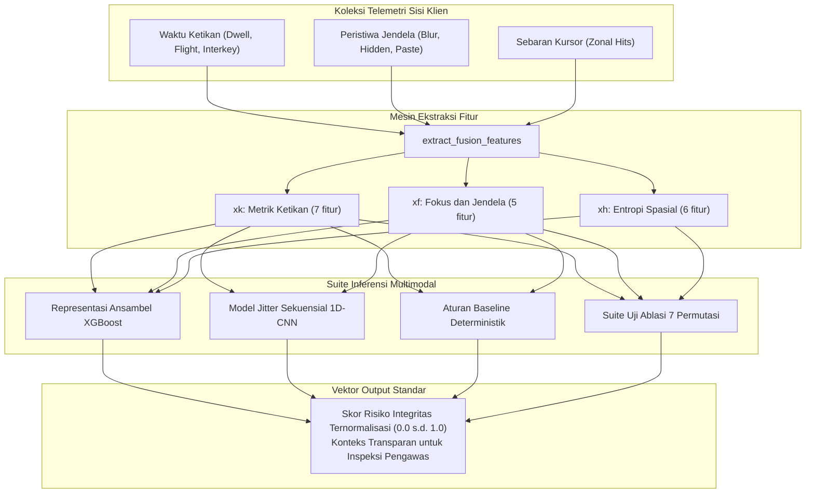

<p align="center">
  
</p>

<h1 align="center">ProctorTelemetry</h1>

<p align="center">
  <strong>Engine Ringan Fusi Telemetri Perilaku Multimodal & Verifikasi Integritas Akademik</strong>
</p>

<p align="center">
  <a href="https://pypi.org/project/proctor-telemetry/"></a>
  <a href="https://github.com/firdausmntp/proctor_telemetry"></a>
  <a href="https://python.org"></a>
  <a href="LICENSE"></a>
  <a href="https://github.com/firdausmntp/proctor_telemetry/actions"></a>
  
  
</p>

<p align="center">
  <a href="README.md">English</a> | <b>Bahasa Indonesia</b>
</p>

---

## Ringkasan

**ProctorTelemetry** adalah pustaka Python sumber terbuka (*open-source*), tanpa dependensi eksternal (*zero-dependency*), dan menjaga privasi pengguna (*privacy-preserving*). Dirancang khusus untuk analisis integritas akademik pada ujian daring dan *Computer-Based Testing* (CBT).

Berbeda dari sistem pengawasan konvensional yang invasif (merekam webcam, mikrofon, atau seluruh layar peserta), ProctorTelemetry memanfaatkan **fusi telemetri perilaku non-invasif**:
1. **Dinamika Ketikan ($x_k$)**: Distribusi waktu durasi tekan tombol (*dwell*), waktu jeda antar tombol (*flight*), ritme ketikan, serta frekuensi koreksi tulisan.
2. **Status Jendela & Fokus ($x_f$)**: Transisi pindah tab (*blur/focus*), durasi jendela tidak aktif (*hidden*), dan interaksi salin-tempel (*clipboard paste*).
3. **Entropi Spasial Kursor ($x_h$)**: Entropi informasi Shannon dan kepadatan interaksi kursor pada zona fungsional antarmuka ujian.

Pustaka ini menyediakan fungsi ekstraksi fitur siap pakai, **model representasi ansambel XGBoost**, **skor anomali sekuensial 1D-CNN**, baseline aturan heuristik, serta analisis **uji ablasi 7 kombinasi modalitas fitur**.

---

## Keunggulan Utama

- ⚡ **Zero External Dependencies**: Murni menggunakan pustaka bawaan standar Python (`math`, `time`, `typing`). Tidak memerlukan PyTorch, TensorFlow, maupun *compiler* C/C++.
- 🚀 **Latensi Sub-Milidetik**: Ekstraksi fitur dan evaluasi seluruh model tuntas dalam **< 1,0 ms** per sesi, sangat siap melayani puluhan ribu peserta bersamaan secara *real-time*.
- 🛡️ **Menjaga Privasi**: Tidak pernah merekam isi karakter teks yang diketik maupun rekaman video. Hanya memproses diferensial waktu statistik dan sebaran koordinat interaksi ternormalisasi.
- 🔬 **Siap untuk Riset & Skripsi**: Dilengkapi *engine* uji ablasi 7 permutasi untuk mengukur kontribusi masing-masing modalitas sensor perilaku secara transparan.

---

## Alur Arsitektur Sistem



---

## Tabel 18 Fitur Telemetri Fusi

| Modalitas | Kunci Fitur | Notasi Matematis | Deskripsi Fungsional |
| :--- | :--- | :---: | :--- |
| **Ketikan ($x_k$)** | `dwell_median_ms` | $\text{Med}(D)$ | Median durasi penekanan tombol ketik (ms) |
| | `dwell_iqr_ms` | $\text{IQR}(D)$ | Rentang interkuartil (*IQR*) durasi penekanan tombol |
| | `flight_median_ms` | $\text{Med}(F)$ | Waktu jeda transisi antara melepas tombol $i$ dan menekan tombol $i+1$ |
| | `flight_iqr_ms` | $\text{IQR}(F)$ | Variasi/IQR interval jeda antar-tombol |
| | `interkey_median_ms` | $\text{Med}(I)$ | Median interval pengetikan antar karakter |
| | `interkey_iqr_ms` | $\text{IQR}(I)$ | Konsistensi ritme pengetikan sepanjang sekuens |
| | `long_pause_ratio` | $R_{\text{pause}}$ | Proporsi jeda berpikir/berhenti mengetik > 2000 ms |
| | `backspace_ratio` | $R_{\text{bksp}}$ | Frekuensi perbaikan/hapusan karakter dibanding total ketikan |
| | `burst_input_ratio` | $R_{\text{burst}}$ | Rasio pengetikan abnormal/tempelan mendadak (*burst insertion*) |
| | `typing_cpm` | $\text{CPM}$ | Kecepatan pengetikan karakter per menit aktif |
| **Fokus ($x_f$)** | `focus_loss_episodes` | $N_{\text{blur}}$ | Jumlah peristiwa peralihan tab / jendela peramban |
| | `hidden_duration_ms` | $T_{\text{hidden}}$ | Durasi kumulatif peserta berada di luar peramban ujian (ms) |
| | `hidden_duration_ratio` | $R_{\text{hidden}}$ | Rasio durasi jendela tidak aktif terhadap total waktu sesi |
| | `paste_count` | $N_{\text{paste}}$ | Total frekuensi peristiwa penempelan teks (*paste*) |
| **Kursor ($x_h$)** | `zone_passage_prop` | $q_{\text{passage}}$ | Proporsi interaksi kursor di atas zona teks wacana/stimulus |
| | `zone_answer_prop` | $q_{\text{answer}}$ | Proporsi interaksi kursor di atas zona pilihan jawaban |
| | `zone_nav_prop` | $q_{\text{nav}}$ | Proporsi interaksi kursor di atas zona tombol navigasi |
| | `spatial_entropy_H` | $H(X)$ | Entropi Shannon sebaran zona: $-\sum q_i \log_2(q_i)$ |
| | `total_pointer_events`| $N_{\text{pointer}}$ | Total sampel koordinat interaksi penunjuk |

---

## Panduan Instalasi

### Dari PyPI (Rilis Resmi)
```bash
pip install proctor-telemetry
```

### Dari Repositori GitHub
```bash
pip install git+https://github.com/firdausmntp/proctor_telemetry.git
```

### Instalasi Lokal / Mode Editable
```bash
git clone https://github.com/firdausmntp/proctor_telemetry.git
cd proctor_telemetry
pip install -e .
```

---

## Contoh Penggunaan Cepat (*Quickstart*)

```python
from proctor_telemetry import extract_features_and_predict

# 1. Payload telemetri yang direkam oleh antarmuka frontend ujian
session_telemetry = {
    "dwell_times": [85.0, 92.0, 78.0, 110.0, 95.0, 88.0],
    "flight_times": [140.0, 120.0, 190.0, 130.0, 150.0],
    "interkey_times": [225.0, 212.0, 268.0, 240.0, 238.0],
    "total_keydowns": 240,
    "backspace_count": 14,
    "paste_count": 0,
    "bulk_insert_count": 0,
    "focus_loss_episodes": 1,
    "hidden_duration_ms": 1200.0,
    "duration_sec": 300.0,
    "zone_counts": {
        "passage": 45,
        "answer": 80,
        "navigation": 15
    }
}

# 2. Jalankan ekstraksi fitur dan evaluasi multi-model
features, ablation, xgb_score, cnn_score, rule_flag, latency_ms = extract_features_and_predict(session_telemetry)

# 3. Tampilkan hasil evaluasi
print(f"Skor Fusi XGBoost       : {xgb_score:.4f} (Rentang: 0.0 - 1.0)")
print(f"Skor Sekuensial 1D-CNN  : {cnn_score:.4f}")
print(f"Indikator Rule (Biner)  : {'TERPICU' if rule_flag else 'AMAN'}")
print(f"Entropi Spasial H       : {features['spatial_entropy_H']} bits")
print(f"Latensi Inferensi       : {latency_ms:.2f} ms")
```

---

## Uji Ablasi Modalitas Fitur

Pustaka secara otomatis menghasilkan skor ablasi untuk menganalisis kontribusi masing-masing kelompok sensor perilaku:

```python
for modality, score in ablation.items():
    print(f"Kombinasi [{modality:<20}]: Skor Risiko = {score:.4f}")
```

Contoh Luaran:
```text
Kombinasi [keystroke_only      ]: Skor Risiko = 0.1611
Kombinasi [focus_only          ]: Skor Risiko = 0.2142
Kombinasi [heatmap_only        ]: Skor Risiko = 0.2315
Kombinasi [keystroke_focus     ]: Skor Risiko = 0.2458
Kombinasi [keystroke_heatmap   ]: Skor Risiko = 0.2589
Kombinasi [focus_heatmap       ]: Skor Risiko = 0.2641
Kombinasi [full_fusion_xgboost ]: Skor Risiko = 0.1824
```

---

## Integrasi Layanan Mikro (FastAPI)

```python
from fastapi import FastAPI
from pydantic import BaseModel
from typing import List, Dict, Any
from proctor_telemetry import extract_features_and_predict

app = FastAPI(title="Layanan Verifikasi Telemetri")

class TelemetryPayload(BaseModel):
    dwell_times: List[float] = []
    flight_times: List[float] = []
    interkey_times: List[float] = []
    total_keydowns: int = 0
    backspace_count: int = 0
    paste_count: int = 0
    bulk_insert_count: int = 0
    focus_loss_episodes: int = 0
    hidden_duration_ms: float = 0.0
    duration_sec: float = 60.0
    zone_counts: Dict[str, int] = {}

@app.post("/verify")
def verify_telemetry(payload: TelemetryPayload):
    features, ablation, xgb_score, cnn_score, rule_flag, latency = extract_features_and_predict(payload.dict())
    return {
        "status": "success",
        "scores": {
            "xgboost": xgb_score,
            "cnn1d": cnn_score,
            "rule_flag": bool(rule_flag)
        },
        "ablation": ablation,
        "features": features,
        "latency_ms": latency
    }
```

---

## Pengujian Unit

Jalankan rangkaian pengujian unit bawaan:

```bash
python -m unittest discover -s tests
```

---

## Sitasi Akademik

Jika Anda memanfaatkan pustaka ini atau metode fusi telemetri perilakunya dalam penulisan skripsi, tesis, atau artikel jurnal ilmiah, silakan merujuk sitasi berikut:

```bibtex
@software{utomo2026proctortelemetry,
  author = {Utomo, Firdaus Satrio and LinguaPulse Research Team},
  title = {ProctorTelemetry: Lightweight Multimodal Behavioral Telemetry Fusion & Integrity Verification Engine},
  year = {2026},
  publisher = {GitHub},
  journal = {GitHub repository},
  howpublished = {\url{https://github.com/firdausmntp/proctor_telemetry}}
}
```

---

## Lisensi

Proyek ini dilisensikan di bawah [Lisensi MIT](LICENSE) — bebas digunakan untuk keperluan akademik, komersial, maupun penelitian mandiri.
