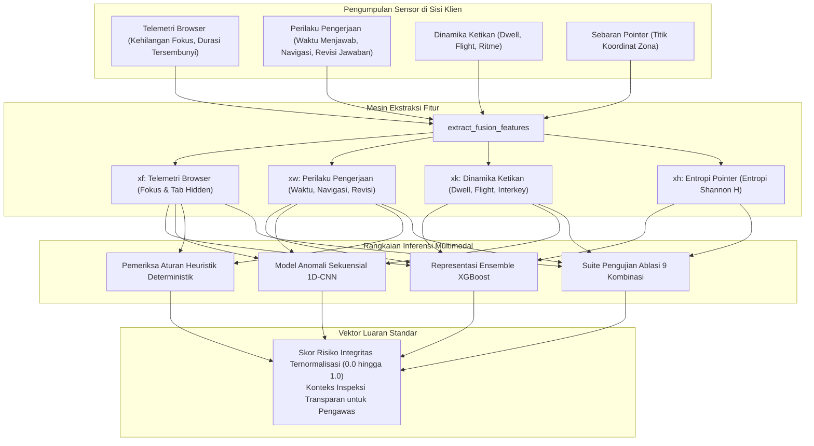

<p align="center">
  
</p>

<h1 align="center">ProctorTelemetry</h1>

<p align="center">
  <strong>Mesin Fusi Multimodal Telemetri Perilaku & Perilaku Pengerjaan Ujian Daring</strong>
</p>

<p align="center">
  <a href="https://pypi.org/project/proctor-telemetry/"></a>
  <a href="https://github.com/firdausmntp/proctor_telemetry"></a>
  <a href="https://python.org"></a>
  <a href="LICENSE"></a>
  <a href="https://github.com/firdausmntp/proctor_telemetry/actions"></a>
  
  
</p>

<p align="center">
  <a href="README.md">English</a> | <b>Bahasa Indonesia</b>
</p>

---

## Ringkasan

**ProctorTelemetry** adalah pustaka Python sumber terbuka (open-source), berorientasi privasi, dan tanpa dependensi eksternal (zero-dependency) yang dirancang untuk analisis integritas akademik pada ujian daring dan Computer-Based Testing (CBT).

Berbeda dari pengawasan konvensional yang invasif (merekam kamera web, mikrofon, atau seluruh layar desktop), ProctorTelemetry menerapkan **fusi perilaku multimodal** dengan menggabungkan dua pilar utama interaksi peserta:
1. **Telemetri Browser ($x_f$)**: Episode kehilangan fokus jendela (blur/unfocus) dan durasi halaman tersembunyi (tab hidden duration).
2. **Perilaku Pengerjaan ($x_w$)**: Distribusi waktu menjawab per butir soal, pola navigasi antarsoal, dan revisi/perubahan jawaban setelah jendela kembali aktif.
3. **Dinamika Ketikan ($x_k$)**: Durasi penekanan tombol (*dwell time*), selang antar-tombol (*flight time*), ritme pengetikan, dan frekuensi koreksi tombol kembali (*backspace*).
4. **Entropi Spasial Pointer ($x_h$)**: Entropi Shannon dari sebaran koordinat interaksi mouse/touch pada zona antarmuka penting.

Dengan memadukan telemetri browser dan perilaku pengerjaan, mesin dapat mendeteksi pola kecurangan secara presisi (contohnya: peserta meninggalkan tab ujian untuk mencari kunci jawaban lalu kembali dan mengubah jawaban yang telah terisi, atau submit kilat bertubi-tubi setelah tab disembunyikan).

---

## Keunggulan Utama

- **Tanpa Dependensi Eksternal**: Dibangun murni menggunakan pustaka standar Python (`math`, `time`, `typing`). Tidak memerlukan NumPy, SciPy, PyTorch, maupun compiler C/C++.
- **Latensi Sub-milidetik**: Ekstraksi fitur dan seluruh evaluasi inferensi multi-model selesai dalam waktu **< 1,0 ms** per sesi ujian, siap melayani puluhan ribu peserta bersamaan.
- **Deteksi Anomali Lintas-Modalitas**: Menghubungkan korelasi temporal antara durasi halaman tersembunyi dengan revisi jawaban atau tebakan cepat.
- **Menjaga Privasi Peserta**: Tidak pernah merekam isi teks ketikan, isi clipboard, video webcam, maupun audio. Hanya selisih waktu statistik dan sebaran koordinat ternormalisasi yang diproses.
- **Rangkaian Uji Ablasi Lengkap**: Menyajikan skor risiko terisolasi per modalitas untuk kebutuhan evaluasi riset skripsi dan transparansi bagi pengawas.

---

## Alur Arsitektur



---

## Vektor Fitur Multimodal (23 Dimensi)

| Modalitas | Kunci Fitur | Simbol Matematis | Keterangan |
| :--- | :--- | :---: | :--- |
| **Telemetri Browser ($x_f$)** | `focus_loss_episodes` | $N_{\text{blur}}$ | Total episode perpindahan fokus / keluar dari jendela ujian |
| | `hidden_duration_ms` | $T_{\text{hidden}}$ | Akumulasi durasi halaman ujian disembunyikan (ms) |
| | `hidden_duration_ratio` | $R_{\text{hidden}}$ | Rasio durasi tersembunyi terhadap total waktu sesi |
| | `paste_count` | $N_{\text{paste}}$ | Total frekuensi aksi penempelan teks (*paste*) |
| **Perilaku Pengerjaan ($x_w$)** | `answer_change_count` | $N_{\text{rev}}$ | Frekuensi pergantian/perubahan opsi jawaban yang sudah dipilih |
| | `answer_change_ratio` | $R_{\text{rev}}$ | Rasio soal yang jawabannya sempat direvisi |
| | `nav_switch_count` | $N_{\text{nav}}$ | Total aksi perpindahan/lompatan navigasi antar-soal |
| | `mean_item_time_sec` | $T_{\text{item}}$ | Rata-rata alokasi waktu pengerjaan per butir soal (detik) |
| | `rapid_answer_count` | $N_{\text{rapid}}$ | Jumlah butir soal yang dijawab kilat di bawah 2,5 detik |
| | `rapid_answer_ratio` | $R_{\text{rapid}}$ | Proporsi jawaban kilat terhadap total soal yang dikerjakan |
| **Dinamika Ketikan ($x_k$)** | `dwell_median_ms` | $\text{Med}(D)$ | Median durasi penekanan tombol ketik (ms) |
| | `dwell_iqr_ms` | $\text{IQR}(D)$ | Rentang antarkuartil (IQR) dari *dwell time* |
| | `flight_median_ms` | $\text{Med}(F)$ | Median jeda waktu antara pelepasan tombol $i$ dan penekanan tombol $i+1$ |
| | `flight_iqr_ms` | $\text{IQR}(F)$ | Variasi konsistensi interval *flight time* |
| | `interkey_median_ms` | $\text{Med}(I)$ | Median selang waktu antar-penekanan tombol (*interkey interval*) |
| | `long_pause_ratio` | $R_{\text{pause}}$ | Proporsi jeda panjang ketikan yang melampaui 1500 ms |
| | `backspace_ratio` | $R_{\text{bksp}}$ | Rasio penekanan tombol koreksi *backspace* terhadap total ketikan |
| | `burst_input_ratio` | $R_{\text{burst}}$ | Proporsi masukan karakter massal mendadak |
| | `typing_cpm` | $\text{CPM}$ | Kecepatan karakter per menit aktif |
| **Entropi Pointer ($x_h$)** | `zone_passage_prop` | $q_{\text{passage}}$ | Proporsi interaksi kursor pada area stimulus/bacaan |
| | `zone_answer_prop` | $q_{\text{answer}}$ | Proporsi interaksi kursor pada area opsi jawaban |
| | `zone_nav_prop` | $q_{\text{nav}}$ | Proporsi interaksi kursor pada panel navigasi |
| | `spatial_entropy_H` | $H(X)$ | Nilai entropi Shannon: $-\sum q_i \log_2(q_i)$ |
| | `total_pointer_events`| $N_{\text{pointer}}$ | Total volume sampel koordinat pointer yang tercatat |

---

## Pemasangan

### Melalui PyPI
```bash
pip install proctor-telemetry
```

### Melalui Repositori GitHub
```bash
pip install git+https://github.com/firdausmntp/proctor_telemetry.git
```

### Mode Pengembangan Lokal
```bash
git clone https://github.com/firdausmntp/proctor_telemetry.git
cd proctor_telemetry
pip install -e .
```

---

## Contoh Penggunaan Cepat

```python
from proctor_telemetry import extract_features_and_predict

# 1. Payload telemetri & perilaku dari antarmuka ujian
payload_sesi = {
    # Telemetri Browser
    "focus_loss_episodes": 2,
    "hidden_duration_ms": 12500.0,
    "paste_count": 0,
    "duration_sec": 300.0,

    # Perilaku Pengerjaan Soal
    "answer_change_count": 3,
    "nav_switch_count": 14,
    "item_response_times": [14.0, 16.5, 1.8, 2.1, 15.2],
    "total_questions_attempted": 20,

    # Dinamika Ketikan
    "dwell_times": [85.0, 92.0, 78.0, 110.0, 95.0, 88.0],
    "flight_times": [140.0, 120.0, 190.0, 130.0, 150.0],
    "interkey_times": [225.0, 212.0, 268.0, 240.0, 238.0],
    "total_keydowns": 240,
    "backspace_count": 14,
    "bulk_insert_count": 0,

    # Sebaran Pointer
    "zone_counts": {
        "passage": 45,
        "answer": 80,
        "navigation": 15
    }
}

# 2. Jalankan inferensi ekstraksi fitur dan evaluasi model
features, ablation, xgb_score, cnn_score, rule_flag, latency_ms = extract_features_and_predict(payload_sesi)

# 3. Tampilkan hasil evaluasi
print(f"Skor Risiko XGBoost Multimodal : {xgb_score:.4f} (Rentang: 0.0 - 1.0)")
print(f"Skor Risiko Sekuensial 1D-CNN  : {cnn_score:.4f}")
print(f"Peringatan Aturan Heuristik   : {'TERDETEKSI ANOMALI' if rule_flag else 'BERSIH'}")
print(f"Fusi Telemetri + Perilaku      : {ablation['telemetry_work_fusion']:.4f}")
print(f"Latensi Inferensi Komputasi    : {latency_ms:.2f} ms")
```

---

## Evaluasi Rangkaian Uji Ablasi

Pustaka secara otomatis menghitung 9 variasi skor ablasi untuk menganalisis kontribusi terisolasi maupun gabungan modalitas:

```python
for modalitas, skor in ablation.items():
    print(f"Sub-kelompok [{modalitas:<22}]: Skor Risiko = {skor:.4f}")
```

Luaran contoh:
```text
Sub-kelompok [keystroke_only        ]: Skor Risiko = 0.1611
Sub-kelompok [focus_only            ]: Skor Risiko = 0.2142
Sub-kelompok [heatmap_only          ]: Skor Risiko = 0.2315
Sub-kelompok [work_behavior_only    ]: Skor Risiko = 0.2840
Sub-kelompok [telemetry_work_fusion ]: Skor Risiko = 0.4215
Sub-kelompok [keystroke_focus       ]: Skor Risiko = 0.2458
Sub-kelompok [keystroke_heatmap     ]: Skor Risiko = 0.2589
Sub-kelompok [focus_heatmap         ]: Skor Risiko = 0.2641
Sub-kelompok [full_fusion_xgboost   ]: Skor Risiko = 0.3892
```

---

## Pengujian Unit

Jalankan rangkaian pengujian bawaan:

```bash
python -m unittest discover -s tests
```

---

## Sitasi Akademik

Apabila Anda memanfaatkan pustaka ini atau metode fusi telemetri dan perilaku pengerjaan dalam penelitian, skripsi, tesis, atau publikasi ilmiah, mohon cantumkan sitasi berikut:

```bibtex
@software{utomo2026proctortelemetry,
  author = {Utomo, Firdaus Satrio and LinguaPulse Research Team},
  title = {ProctorTelemetry: Lightweight Multimodal Behavioral Telemetry & Test-Taking Work Behavior Fusion Engine},
  year = {2026},
  publisher = {GitHub},
  journal = {GitHub repository},
  howpublished = {\url{https://github.com/firdausmntp/proctor_telemetry}}
}
```

---

## Lisensi

Proyek ini berada di bawah naungan [Lisensi MIT](LICENSE) — bebas dimanfaatkan untuk kebutuhan akademik, riset, maupun komersial.
