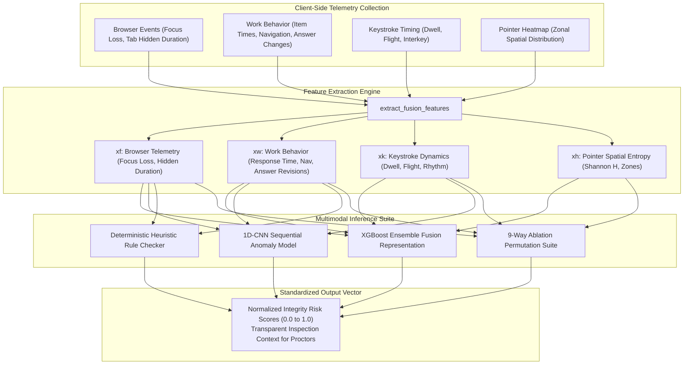

<p align="center">
  
</p>

<h1 align="center">ProctorTelemetry</h1>

<p align="center">
  <strong>Lightweight Multimodal Behavioral Telemetry & Test-Taking Work Behavior Fusion Engine</strong>
</p>

<p align="center">
  <a href="https://pypi.org/project/proctor-telemetry/"></a>
  <a href="https://github.com/firdausmntp/proctor_telemetry"></a>
  <a href="https://python.org"></a>
  <a href="LICENSE"></a>
  <a href="https://github.com/firdausmntp/proctor_telemetry/actions"></a>
  
  
</p>

<p align="center">
  <b>English</b> | <a href="README.id.md">Bahasa Indonesia</a>
</p>

---

## Overview

**ProctorTelemetry** is an open-source, privacy-preserving, zero-dependency Python library engineered for academic integrity verification in online assessments and computer-based testing (CBT).

Rather than relying on intrusive video/audio surveillance, ProctorTelemetry performs **multimodal behavioral fusion** by correlating two primary pillars of student interaction:
1. **Browser Telemetry ($x_f$)**: Window focus loss episodes, tab background visibility, and hidden duration.
2. **Test-Taking Work Behavior ($x_w$)**: Item response time distributions, question navigation patterns, and post-blur answer revisions.
3. **Typing Rhythm & Dynamics ($x_k$)**: Keystroke dwell duration, flight times, interkey intervals, and backspace rates.
4. **Pointer Spatial Entropy ($x_h$)**: Spatial interaction density and Shannon entropy across UI zones.

By fusing browser telemetry with work behavior, the engine reliably identifies subtle cheating signatures (e.g. switching tabs to consult external resources and returning to revise answers, or mass-submitting answers within milliseconds after prolonged background hidden states).

---

## Key Highlights

- **Zero External Dependencies**: Implemented entirely with Python standard libraries (`math`, `time`, `typing`). No NumPy, SciPy, PyTorch, or compiler dependencies.
- **Sub-millisecond Inference**: Feature extraction and all multi-model evaluations run in **< 1.0 ms** per session, easily handling tens of thousands of concurrent examinees.
- **Cross-Modal Correlative Anomaly Detection**: Detects temporal correlations between browser focus loss and answer revisions.
- **Privacy-First Design**: Never records keystroke text, clipboard contents, webcam feeds, or audio. Only statistical timing differentials and normalized coordinate distributions are evaluated.
- **Comprehensive Ablation Suite**: Outputs isolated and fused sub-scores for detailed academic evaluation and model transparency.

---

## Architecture Pipeline



---

## Extracted Multimodal Features (23-D Vector)

| Modality | Feature Key | Mathematical Symbol | Description |
| :--- | :--- | :---: | :--- |
| **Browser Telemetry ($x_f$)** | `focus_loss_episodes` | $N_{\text{blur}}$ | Total browser tab / window defocus transitions |
| | `hidden_duration_ms` | $T_{\text{hidden}}$ | Cumulative time spent outside the exam interface (ms) |
| | `hidden_duration_ratio` | $R_{\text{hidden}}$ | Ratio of hidden time relative to total session duration |
| | `paste_count` | $N_{\text{paste}}$ | Total clipboard paste occurrences |
| **Work Behavior ($x_w$)** | `answer_change_count` | $N_{\text{rev}}$ | Frequency of answer choices revised after initial selection |
| | `answer_change_ratio` | $R_{\text{rev}}$ | Proportion of attempted questions with revised answers |
| | `nav_switch_count` | $N_{\text{nav}}$ | Total jumps across question navigation controls |
| | `mean_item_time_sec` | $T_{\text{item}}$ | Average active response time allocated per question (sec) |
| | `rapid_answer_count` | $N_{\text{rapid}}$ | Number of questions answered in under 2.5 seconds |
| | `rapid_answer_ratio` | $R_{\text{rapid}}$ | Ratio of rapid answers relative to attempted questions |
| **Keystroke ($x_k$)** | `dwell_median_ms` | $\text{Med}(D)$ | Median key press hold duration (ms) |
| | `dwell_iqr_ms` | $\text{IQR}(D)$ | Interquartile range of dwell times |
| | `flight_median_ms` | $\text{Med}(F)$ | Median time between releasing key $i$ and pressing key $i+1$ |
| | `flight_iqr_ms` | $\text{IQR}(F)$ | Variance/IQR of flight intervals |
| | `interkey_median_ms` | $\text{Med}(I)$ | Median inter-keystroke interval |
| | `long_pause_ratio` | $R_{\text{pause}}$ | Proportion of interkey pauses exceeding 1500 ms |
| | `backspace_ratio` | $R_{\text{bksp}}$ | Frequency of backspace revisions relative to keystrokes |
| | `burst_input_ratio` | $R_{\text{burst}}$ | Ratio of sudden bulk/paste typing bursts |
| | `typing_cpm` | $\text{CPM}$ | Characters typed per active minute |
| **Pointer ($x_h$)** | `zone_passage_prop` | $q_{\text{passage}}$ | Proportion of pointer interactions over stimulus/passage |
| | `zone_answer_prop` | $q_{\text{answer}}$ | Proportion of pointer interactions over answer choices |
| | `zone_nav_prop` | $q_{\text{nav}}$ | Proportion of pointer interactions over navigation controls |
| | `spatial_entropy_H` | $H(X)$ | Shannon entropy across zones: $-\sum q_i \log_2(q_i)$ |
| | `total_pointer_events`| $N_{\text{pointer}}$ | Sampled coordinate interaction volume |

---

## Installation

### From PyPI
```bash
pip install proctor-telemetry
```

### From GitHub Repository
```bash
pip install git+https://github.com/firdausmntp/proctor_telemetry.git
```

### Local Development / Editable Mode
```bash
git clone https://github.com/firdausmntp/proctor_telemetry.git
cd proctor_telemetry
pip install -e .
```

---

## Quickstart

```python
from proctor_telemetry import extract_features_and_predict

# 1. Telemetry payload captured by frontend client
session_telemetry = {
    # Browser Telemetry
    "focus_loss_episodes": 2,
    "hidden_duration_ms": 14500.0,
    "paste_count": 0,
    "duration_sec": 300.0,
    
    # Test-Taking Work Behavior
    "answer_change_count": 3,
    "nav_switch_count": 12,
    "item_response_times": [14.2, 18.0, 1.8, 1.9, 12.5],
    "total_questions_attempted": 20,

    # Keystroke Dynamics
    "dwell_times": [85.0, 92.0, 78.0, 110.0, 95.0, 88.0],
    "flight_times": [140.0, 120.0, 190.0, 130.0, 150.0],
    "interkey_times": [225.0, 212.0, 268.0, 240.0, 238.0],
    "total_keydowns": 240,
    "backspace_count": 14,
    "bulk_insert_count": 0,

    # Pointer Spatial Distribution
    "zone_counts": {
        "passage": 45,
        "answer": 80,
        "navigation": 15
    }
}

# 2. Execute feature extraction & multimodal evaluation
features, ablation, xgb_score, cnn_score, rule_flag, latency_ms = extract_features_and_predict(session_telemetry)

# 3. Inspect results
print(f"XGBoost Multimodal Score : {xgb_score:.4f} (Range: 0.0 - 1.0)")
print(f"1D-CNN Sequential Score  : {cnn_score:.4f}")
print(f"Rule Flag (Deterministic): {'FLAGGED' if rule_flag else 'CLEAN'}")
print(f"Telemetry-Work Fusion    : {ablation['telemetry_work_fusion']:.4f}")
print(f"Inference Latency        : {latency_ms:.2f} ms")
```

---

## Advanced Usage: Feature Ablation Analysis

The library outputs 9 distinct ablation configurations to examine isolated and fused contributions:

```python
for modality, score in ablation.items():
    print(f"Subset [{modality:<22}]: Risk Score = {score:.4f}")
```

Example Output:
```text
Subset [keystroke_only        ]: Risk Score = 0.1611
Subset [focus_only            ]: Risk Score = 0.2142
Subset [heatmap_only          ]: Risk Score = 0.2315
Subset [work_behavior_only    ]: Risk Score = 0.2840
Subset [telemetry_work_fusion ]: Risk Score = 0.4215
Subset [keystroke_focus       ]: Risk Score = 0.2458
Subset [keystroke_heatmap     ]: Risk Score = 0.2589
Subset [focus_heatmap         ]: Risk Score = 0.2641
Subset [full_fusion_xgboost   ]: Risk Score = 0.3892
```

---

## Web Framework Integration

### FastAPI Microservice Example
```python
from fastapi import FastAPI
from pydantic import BaseModel
from typing import List, Dict, Any
from proctor_telemetry import extract_features_and_predict

app = FastAPI(title="Proctor Telemetry API")

class TelemetryPayload(BaseModel):
    focus_loss_episodes: int = 0
    hidden_duration_ms: float = 0.0
    paste_count: int = 0
    duration_sec: float = 60.0
    answer_change_count: int = 0
    nav_switch_count: int = 0
    item_response_times: List[float] = []
    dwell_times: List[float] = []
    flight_times: List[float] = []
    interkey_times: List[float] = []
    total_keydowns: int = 0
    backspace_count: int = 0
    bulk_insert_count: int = 0
    zone_counts: Dict[str, int] = {}

@app.post("/verify")
def verify_telemetry(payload: TelemetryPayload):
    features, ablation, xgb_score, cnn_score, rule_flag, latency = extract_features_and_predict(payload.dict())
    return {
        "status": "success",
        "scores": {
            "xgboost": xgb_score,
            "cnn1d": cnn_score,
            "rule_flag": bool(rule_flag)
        },
        "ablation": ablation,
        "features": features,
        "latency_ms": latency
    }
```

---

## Unit Testing

Run the built-in test suite:

```bash
python -m unittest discover -s tests
```

---

## Academic Citation

If you use this library or its multimodal telemetry and work behavior fusion methodology in academic papers, undergraduate theses, or research publications, please cite:

```bibtex
@software{utomo2026proctortelemetry,
  author = {Utomo, Firdaus Satrio and LinguaPulse Research Team},
  title = {ProctorTelemetry: Lightweight Multimodal Behavioral Telemetry & Test-Taking Work Behavior Fusion Engine},
  year = {2026},
  publisher = {GitHub},
  journal = {GitHub repository},
  howpublished = {\url{https://github.com/firdausmntp/proctor_telemetry}}
}
```

---

## License

This project is licensed under the [MIT License](LICENSE) - free to use in academic, commercial, or personal software.
