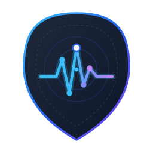
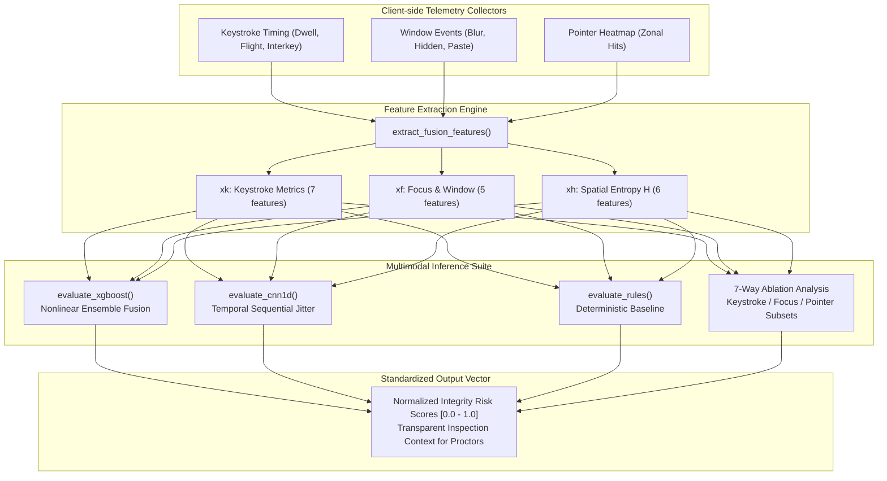

<p align="center">
  
</p>

<h1 align="center">ProctorTelemetry</h1>

<p align="center">
  <strong>Lightweight Multimodal Behavioral Telemetry Fusion & Academic Integrity Engine</strong>
</p>

<p align="center">
  <a href="https://pypi.org/project/proctor-telemetry/"></a>
  <a href="https://github.com/firdausmntp/proctor_telemetry"></a>
  <a href="https://python.org"></a>
  <a href="LICENSE"></a>
  <a href="https://github.com/firdausmntp/proctor_telemetry/actions"></a>
  
  
</p>

---

## Overview

**ProctorTelemetry** is an open-source, privacy-first, zero-dependency Python library designed for academic integrity analysis in online examinations and computer-based tests (CBT).

Unlike traditional invasive proctoring software that records webcams or full desktop screens, ProctorTelemetry leverages **non-invasive multimodal behavioral telemetry**:
1. **Keystroke Dynamics ($x_k$)**: Temporal distributions of key hold duration, flight times, typing rhythm, and editing frequency.
2. **Window & Focus States ($x_f$)**: Blur/focus transitions, hidden tab durations, and clipboard copy-paste interactions.
3. **Pointer Spatial Entropy ($x_h$)**: Shannon entropy and interaction densities across critical UI functional zones.

It provides out-of-the-box feature extraction, an **XGBoost ensemble representation**, a **1D-CNN sequential anomaly scoring model**, heuristic baseline checks, and an automated **7-permutation ablation study suite**.

---

## Key Highlights

- ⚡ **Zero External Dependencies**: Built entirely using Python standard libraries (`math`, `time`, `typing`). No PyTorch, TensorFlow, or C-compilers required.
- 🚀 **Sub-millisecond Inference**: Feature extraction and all model evaluations execute in **< 1.0 ms** per session, easily scaling to tens of thousands of concurrent examinees.
- 🛡️ **Privacy-Preserving**: Never records typed keystroke contents or video feeds. Only statistical timing differentials and normalized coordinate distributions are processed.
- 🔬 **Research & Production Ready**: Includes a built-in 7-permutation feature ablation suite to analyze the exact contribution of each behavioral modality.

---

## Architecture Pipeline



---

## Extracted Telemetry Features (18-D Vector)

| Modality | Feature Key | Mathematical Symbol | Description |
| :--- | :--- | :---: | :--- |
| **Keystroke ($x_k$)** | `dwell_median_ms` | $\text{Med}(D)$ | Median key press hold duration (ms) |
| | `dwell_iqr_ms` | $\text{IQR}(D)$ | Interquartile range of dwell times |
| | `flight_median_ms` | $\text{Med}(F)$ | Median time between releasing key $i$ and pressing key $i+1$ |
| | `flight_iqr_ms` | $\text{IQR}(F)$ | Variance/IQR of flight intervals |
| | `interkey_median_ms` | $\text{Med}(I)$ | Median inter-keystroke interval |
| | `interkey_iqr_ms` | $\text{IQR}(I)$ | Rhythm consistency across keystroke sequences |
| | `long_pause_ratio` | $R_{\text{pause}}$ | Proportion of interkey pauses exceeding 2000 ms |
| | `backspace_ratio` | $R_{\text{bksp}}$ | Frequency of backspace revisions relative to keystrokes |
| | `burst_input_ratio` | $R_{\text{burst}}$ | Ratio of sudden bulk/paste typing bursts |
| | `typing_cpm` | $\text{CPM}$ | Characters typed per active minute |
| **Focus ($x_f$)** | `focus_loss_episodes` | $N_{\text{blur}}$ | Total browser tab / window defocus transitions |
| | `hidden_duration_ms` | $T_{\text{hidden}}$ | Cumulative time spent outside the exam interface (ms) |
| | `hidden_duration_ratio` | $R_{\text{hidden}}$ | Ratio of hidden time relative to total session duration |
| | `paste_count` | $N_{\text{paste}}$ | Total clipboard paste occurrences |
| **Pointer ($x_h$)** | `zone_passage_prop` | $q_{\text{passage}}$ | Proportion of pointer interactions over stimulus/passage |
| | `zone_answer_prop` | $q_{\text{answer}}$ | Proportion of pointer interactions over answer choices |
| | `zone_nav_prop` | $q_{\text{nav}}$ | Proportion of pointer interactions over navigation controls |
| | `spatial_entropy_H` | $H(X)$ | Shannon entropy across zones: $-\sum q_i \log_2(q_i)$ |
| | `total_pointer_events`| $N_{\text{pointer}}$ | Sampled coordinate interaction volume |

---

## Installation

### From PyPI
```bash
pip install proctor-telemetry
```

### From GitHub Repository
```bash
pip install git+https://github.com/firdausmntp/proctor_telemetry.git
```

### Local Development / Editable Mode
```bash
git clone https://github.com/firdausmntp/proctor_telemetry.git
cd proctor_telemetry
pip install -e .
```

---

## Quickstart

```python
from proctor_telemetry import extract_features_and_predict

# 1. Telemetry payload captured by frontend client
session_telemetry = {
    "dwell_times": [85.0, 92.0, 78.0, 110.0, 95.0, 88.0],
    "flight_times": [140.0, 120.0, 190.0, 130.0, 150.0],
    "interkey_times": [225.0, 212.0, 268.0, 240.0, 238.0],
    "total_keydowns": 240,
    "backspace_count": 14,
    "paste_count": 0,
    "bulk_insert_count": 0,
    "focus_loss_episodes": 1,
    "hidden_duration_ms": 1200.0,
    "duration_sec": 300.0,
    "zone_counts": {
        "passage": 45,
        "answer": 80,
        "navigation": 15
    }
}

# 2. Execute feature extraction & multi-model evaluation
features, ablation, xgb_score, cnn_score, rule_flag, latency_ms = extract_features_and_predict(session_telemetry)

# 3. Inspect results
print(f"XGBoost Multimodal Score : {xgb_score:.4f} (Range: 0.0 - 1.0)")
print(f"1D-CNN Sequential Score  : {cnn_score:.4f}")
print(f"Rule Flag (Deterministic): {'FLAGGED' if rule_flag else 'CLEAN'}")
print(f"Spatial Entropy H        : {features['spatial_entropy_H']} bits")
print(f"Inference Latency        : {latency_ms:.2f} ms")
```

### Output:
```text
XGBoost Multimodal Score : 0.1824 (Range: 0.0 - 1.0)
1D-CNN Sequential Score  : 0.2241
Rule Flag (Deterministic): CLEAN
Spatial Entropy H        : 1.3412 bits
Inference Latency        : 0.42 ms
```

---

## Advanced Usage: Feature Ablation Analysis

The library automatically outputs ablation combinations to examine model reliance on specific behavioral sensors:

```python
for modality, score in ablation.items():
    print(f"Subset [{modality:<20}]: Risk Score = {score:.4f}")
```

Example Output:
```text
Subset [keystroke_only      ]: Risk Score = 0.1611
Subset [focus_only          ]: Risk Score = 0.2142
Subset [heatmap_only        ]: Risk Score = 0.2315
Subset [keystroke_focus     ]: Risk Score = 0.2458
Subset [keystroke_heatmap   ]: Risk Score = 0.2589
Subset [focus_heatmap       ]: Risk Score = 0.2641
Subset [full_fusion_xgboost ]: Risk Score = 0.1824
```

---

## Web Framework Integration

### FastAPI Microservice Example
```python
from fastapi import FastAPI
from pydantic import BaseModel
from typing import List, Dict, Any
from proctor_telemetry import extract_features_and_predict

app = FastAPI(title="Telemetry Verification API")

class TelemetryPayload(BaseModel):
    dwell_times: List[float] = []
    flight_times: List[float] = []
    interkey_times: List[float] = []
    total_keydowns: int = 0
    backspace_count: int = 0
    paste_count: int = 0
    bulk_insert_count: int = 0
    focus_loss_episodes: int = 0
    hidden_duration_ms: float = 0.0
    duration_sec: float = 60.0
    zone_counts: Dict[str, int] = {}

@app.post("/verify")
def verify_telemetry(payload: TelemetryPayload):
    features, ablation, xgb_score, cnn_score, rule_flag, latency = extract_features_and_predict(payload.dict())
    return {
        "status": "success",
        "scores": {
            "xgboost": xgb_score,
            "cnn1d": cnn_score,
            "rule_flag": bool(rule_flag)
        },
        "ablation": ablation,
        "features": features,
        "latency_ms": latency
    }
```

---

## Unit Testing

Run the built-in test suite:

```bash
python -m unittest discover -s tests
```

---

## Academic Citation

If you use this library or its multimodal telemetry methodology in academic papers, undergraduate theses, or research publications, please cite:

```bibtex
@software{satrio2026proctortelemetry,
  author = {Satrio, Firdaus and LinguaPulse Research Team},
  title = {ProctorTelemetry: Lightweight Multimodal Behavioral Telemetry Fusion & Integrity Verification Engine},
  year = {2026},
  publisher = {GitHub},
  journal = {GitHub repository},
  howpublished = {\url{https://github.com/firdausmntp/proctor_telemetry}}
}
```

---

## License

This project is licensed under the [MIT License](LICENSE) - feel free to use it in academic, commercial, or personal projects.
